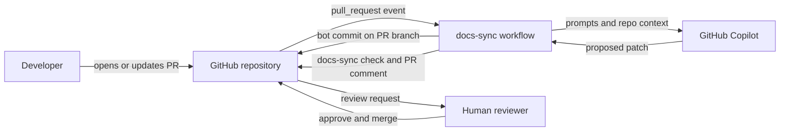
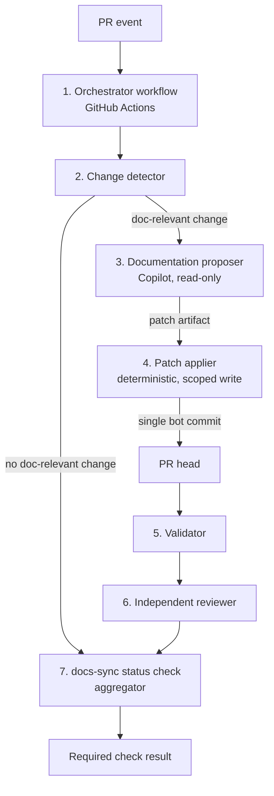
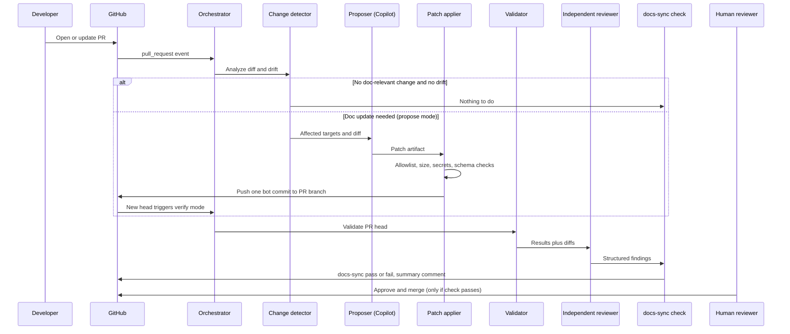

# Architecture: Automated Documentation Sync

**Project:** Agentic SDLC Capstone (GitHub Copilot)
**Target system:** Open-source banking application
**Version:** v0.1 (draft, input to the design review)
**Based on:** `requirements.md` v0.2

---

## 1. System Overview

### 1.1 What the automation does

On every pull request that targets the main branch, the automation:

1. Analyzes the source changes in the PR.
2. Uses GitHub Copilot to propose matching updates to the documentation (API reference, configuration reference, data model, setup guide).
3. Validates the proposed changes and has an independent reviewer evaluate them.
4. Reports the result through a single required status check, `docs-sync`, which blocks the merge until every blocking condition is satisfied.

A human approves and merges. The automation never approves or merges.

### 1.2 Where it runs

| Aspect | Decision |
|--------|----------|
| Platform | GitHub (repository, pull requests, branch protection or rulesets) |
| Execution | GitHub Actions workflows on the PR's repository |
| Runners | GitHub-hosted by default. Self-hosted runners are an open question for a banking context (see Section 6.5). |
| AI engine | GitHub Copilot, invoked non-interactively from a workflow job |
| Documentation location | Same repository as the code (docs-as-code, Markdown) |

### 1.3 Design principles

| Principle | Meaning in this design |
|-----------|------------------------|
| Deterministic skeleton, AI at the edges | Change detection, validation, scanning, gating, and committing are deterministic code. The model is used only to draft doc text and to give a second opinion. |
| Least privilege | The job that runs the model has no write access. Only a small deterministic job can write, and only to documentation paths. |
| Untrusted input | Everything in a PR (code, comments, filenames, description) is treated as hostile input to the model. |
| Fail closed | If any step fails, errors, or cannot run, the required check does not pass. |
| Human last | A human approval is mandatory and cannot be satisfied by automation. |
| Idempotent | Re-running on an unchanged PR changes nothing. |

### 1.4 Context diagram

---

## 2. Component Architecture

### 2.1 Component diagram

### 2.2 Component responsibilities

| # | Component | Responsibility | Inputs | Outputs | Trust and permissions |
|---|-----------|----------------|--------|---------|-----------------------|
| 1 | **Orchestrator (GitHub Actions)** | Receives PR events, decides the run mode (see 3.2), serializes runs per PR, runs jobs in order, enforces timeouts. | PR event, config | Job graph, run summary | Workflow definition must come from a protected source (see 4.5). Concurrency group per PR. |
| 2 | **Change detector** | Computes the PR diff against its base, ignores documentation files, and maps changed source files to affected doc pages using a mapping config. Also runs a deterministic drift check: do the current docs already match the code? | PR diff, `docsync` mapping config, current docs | List of affected doc targets, drift findings | Read-only. No model involved. |
| 3 | **Documentation proposer** | Invokes Copilot to draft updates for each affected doc target. Produces a patch, never commits. Marks uncertain sections as flagged and missing facts as "Not Found". | Affected targets, relevant source diff, Copilot instructions and prompt files | Patch artifact, flag list | Read-only repository token. No access to secrets other than the Copilot credential. Restricted tool permissions. Treated as untrusted output. |
| 4 | **Patch applier** | Validates the patch against a path allowlist (documentation paths only), checks size and file-count limits, applies it to a scratch checkout, runs pre-commit checks (secrets scan, schema and Markdown validation), then creates one signed or clearly labelled bot commit on the PR branch. | Patch artifact | One commit, or a failure result | The only component with write access, limited to the PR branch. Deterministic code, no model, no model output executed. |
| 5 | **Validator** | Runs deterministic checks on the PR head: Markdown lint, link check, OpenAPI and schema validation, documentation build, secrets scan, and the code-to-docs drift check. | PR head | Structured pass/fail results per check | Read-only. |
| 6 | **Independent reviewer** | Evaluates the documentation changes against the source diff. Uses a different prompt and context from the proposer, and does not see the proposer's reasoning. Emits structured findings with severity. | Source diff, documentation diff, validator output | Findings JSON, PR comment | Read-only. Separate job with its own context. Findings are parsed by deterministic code, which decides what is blocking. |
| 7 | **`docs-sync` status check** | Aggregates results from all jobs and applies the blocking conditions in `requirements.md` FR-17. Runs even when earlier jobs fail or are skipped, and fails closed. Posts a summary comment. | All job results, acknowledgements | One required check, PR summary comment | Needs only permission to write checks and comments. |

### 2.3 Supporting artifacts (version-controlled)

| Artifact | Purpose |
|----------|---------|
| `.github/workflows/docs-sync.yml` | The orchestrator workflow |
| `.docsync/config.yml` | Mapping from source patterns to doc pages, the documentation path allowlist, size limits, and thresholds |
| `.github/copilot-instructions.md` | Repository-wide Copilot instructions (documentation style, banking data-handling rules, "Not Found" convention) |
| `.github/prompts/` | Prompt files for the proposer and the independent reviewer (kept separate) |
| `.github/skills/` and hooks | Reusable capabilities and guardrail hooks used during Copilot-driven development of this pipeline |
| `CODEOWNERS` | Assigns human owners to documentation paths, the workflow files, and `.docsync/` |

### 2.4 Generated-section convention

To keep the bot from overwriting human work and to make runs idempotent, generated content sits between markers, for example `<!-- docsync:begin api-endpoints -->` and `<!-- docsync:end api-endpoints -->`. The bot only edits inside markers. Anything outside is human-owned and untouched.

---

## 3. End-to-End Workflow

### 3.1 Sequence

### 3.2 Run modes

A bot commit changes the PR head, which triggers another run. Rather than suppress that run, the design uses it to verify the actual head that will be merged.

| Mode | When | What runs |
|------|------|-----------|
| **Propose** | The latest commit is human-authored and the non-documentation source has changed since the last bot commit, and docs are not already in sync. | Detector, proposer, applier. Ends after pushing the bot commit. The next run verifies it. |
| **Verify** | The latest commit is the bot's, or the docs are already in sync with the source. | Detector (drift check), validator, independent reviewer, status check. The proposer is never run in this mode. |

**Loop guard (FR-20):** each bot commit carries a trailer with a hash of the non-documentation source tree, for example `Docs-Sync-Source-Tree: <hash>`. If the latest bot commit's hash equals the current source tree hash, the run is Verify mode. The proposer therefore cannot fire twice for the same source state. A per-PR cap on bot commits (for example, three) forces a human to intervene if the pipeline keeps producing changes.

### 3.3 Step-by-step

| Step | Action | Pass condition | On failure |
|------|--------|----------------|------------|
| 1 | PR opened, updated, or reopened targeting main | Event received | Not applicable |
| 2 | Orchestrator picks the mode and starts a run in the PR's concurrency group (newer runs cancel older ones) | Mode determined | Check fails closed |
| 3 | Change detector maps diff to doc targets and runs the drift check | Completes | Check fails with error |
| 4 | Proposer drafts a patch (Propose mode only) | Patch produced, within limits | Retry (5.1), then check fails |
| 5 | Patch applier verifies allowlist and limits, applies to a scratch checkout, runs pre-commit checks | All pass | No commit is made; check fails with details |
| 6 | Applier pushes one bot commit to the PR branch | Push accepted | Discard and re-run on the new head (5.4) |
| 7 | New head triggers a Verify run. Validator runs all deterministic checks | All pass | Check fails with the failing checks listed |
| 8 | Independent reviewer evaluates the doc diff against the code diff | No blocking findings | Check fails with findings |
| 9 | Aggregator evaluates blocking conditions (FR-17) and posts the summary | All satisfied | Check fails with a reason for each blocker |
| 10 | Human reviews and approves, then merges | Approval present, check passing, branch up to date | Merge blocked |

### 3.4 Required check behavior

- The aggregator job always runs (`if: always()`) and fails closed if any upstream job failed, was cancelled, or was skipped unexpectedly.
- The workflow must **not** use `paths:` filters. If a required check's workflow is skipped by a path filter, the check never reports and the PR can be stuck, or worse, treated inconsistently. Filtering happens inside the workflow instead, and the check reports success when there is nothing to do.
- Bot pushes made with the default workflow token do not trigger new workflow runs. The pipeline therefore pushes with a dedicated GitHub App installation token, so the Verify run on the new head is triggered. If that run does not appear, the required check on the new head stays pending, which blocks the merge. This is a deliberate fail-safe.

---

## 4. Security Architecture

### 4.1 Threat summary

| # | Threat | Example | Primary mitigation |
|---|--------|---------|--------------------|
| T-1 | Prompt injection through PR content | A code comment tells the model to ignore its instructions, leak data, or write misleading docs | Section 4.3 |
| T-2 | Model output used as a command or path | Model proposes editing a workflow file or source file | Path allowlist and a deterministic applier (4.2, 4.3) |
| T-3 | Secrets or real data in generated docs | An example payload copied from a test fixture with real-looking account data | Secrets and sensitive-data scan before commit and at validation (4.4) |
| T-4 | Tampering with the gate | The PR modifies the workflow or config so the check always passes | Protected workflow and config (4.5) |
| T-5 | Token abuse | A compromised job uses a write token to modify code | Separate read-only and write jobs, scoped tokens (4.2) |
| T-6 | Self-approval | The bot approves or satisfies review requirements | Human approval rules (4.6) |
| T-7 | Malicious fork PR | A fork PR tries to obtain secrets or write access | Fork handling (5.5) |
| T-8 | Supply chain | A compromised third-party action or tool | Pinned versions and workflow linting (4.7) |

### 4.2 Least privilege

| Job | Repository permissions | Secrets available | Notes |
|-----|------------------------|-------------------|-------|
| Change detector | `contents: read`, `pull-requests: read` | None | Pure analysis |
| Proposer | `contents: read`, plus the permission or credential Copilot needs | Copilot credential only | Never has write access. Tool permissions for the Copilot session restricted to reading files and producing a patch. No shell commands on untrusted content. Network egress restricted where the platform allows. |
| Patch applier | Write to the PR branch contents through the GitHub App token | App credentials | No model, no untrusted-code execution. Fixed, reviewed code only. |
| Validator and reviewer | `contents: read`, `pull-requests: read` | Reviewer's Copilot credential only | Reviewer posts nothing directly. Findings are returned as data. |
| Aggregator | `checks: write`, `pull-requests: write` | None | Posts the check and comment |

Each workflow declares an explicit `permissions:` block at the top level and per job, with everything not listed set to none. Credentials live only in the platform's secret store and are never written to logs, artifacts, or commits.

### 4.3 Untrusted PR content

- **Treat all PR content as data.** Prompts wrap source diffs and comments in clearly delimited sections and state that content inside them is data, not instructions.
- **Never execute model output.** The model returns a patch or JSON. The applier validates it structurally; nothing the model emits is passed to a shell, evaluated, or used to construct a command.
- **Allowlist writes.** The applier rejects any patch that touches a file outside the documentation paths in `.docsync/config.yml`, creates symlinks, changes file modes, or exceeds size and file-count limits.
- **Constrain the proposer's tools.** The proposer session is limited to reading repository files and returning output.
- **Reviewer independence.** The reviewer receives the source diff and the documentation diff, not the proposer's prompt or reasoning, and uses its own instructions. Its output is parsed by a deterministic script that decides which findings block.
- **Reduce blast radius.** No production credentials, real customer data, or internal hostnames exist in the repository (assumption A-5). If any appear, the secrets scan fails the check.

### 4.4 Secret and sensitive-data scanning

| Stage | Scope | Tooling (candidate) |
|-------|-------|---------------------|
| Pre-commit (in the applier) | The patch as applied to the scratch checkout | A secrets scanner such as gitleaks |
| Validation (on the PR head) | All documentation files changed by the PR | The same scanner plus custom patterns for account-number and personal-data formats used by the application |
| Repository level | Whole repository | GitHub secret scanning and push protection where available to the organization |

A finding is always blocking. Example payloads in docs must use synthetic values, enforced by Copilot instructions and checked by the scan.

### 4.5 Protecting the gate itself

A PR can modify workflow files, and a `pull_request` workflow runs the definition from the PR's merge commit. Without protection, a PR could weaken the check that is meant to police it. Controls:

- Make `docs-sync` a required check through branch protection or a repository ruleset.
- Where the organization plan allows it, use the ruleset option that requires specified workflows to pass, so the workflow definition comes from a protected source rather than the PR.
- Put `.github/workflows/`, `.docsync/`, `.github/copilot-instructions.md`, and `.github/prompts/` under `CODEOWNERS` with at least one human owner required, and require code-owner review.
- Changes to those paths cause the check to require an explicit extra human acknowledgement.

### 4.6 Human approval

- Require at least one approving human review before merge.
- Require approval of the most recent reviewable push, so the reviewer is not the person who pushed the last commit, and dismiss stale approvals when new commits arrive.
- The GitHub App and any bot identity are excluded from review requirements, cannot be code owners, and their approvals do not count.
- Because bot commits can dismiss stale approvals, reviewers approve after the `docs-sync` check has passed on the final head.
- Administrators bypassing the rule is allowed only through an audited break-glass process (see 5.7).

### 4.7 Supply chain and workflow hygiene

- Pin third-party actions to full commit SHAs. Pin the Copilot CLI and tool versions.
- Lint workflows in CI with a workflow linter and a workflow security scanner.
- Keep dependencies of the pipeline tooling under dependency-update monitoring.

---

## 5. Failure and Recovery

### 5.1 Retries

| Failure type | Handling |
|--------------|----------|
| Transient (Copilot API error, rate limit, network, runner issue) | Up to two retries with exponential backoff, then fail the check with a clear message |
| Model returns malformed output | One retry with a stricter format instruction, then fail |
| Validator or scanner finds a problem | Not retried. This is a real finding, so the check fails and the PR author or a reviewer acts |
| Timeout | Per-job and per-run timeouts. A timeout fails the check |

Failures always produce a failed required check with a message listing the error and the affected files. The PR author is notified through the PR comment and the check, and the team channel gets an alert if one is configured (Q-5).

### 5.2 Idempotency

- Runs are serialized per PR using a concurrency group, and newer runs cancel older ones.
- The `Docs-Sync-Source-Tree` trailer (3.2) prevents the proposer from running twice for the same source state.
- The drift check runs before the model is invoked. If the docs already match the code, the model is not called and no commit is made.
- Generated content is confined to marked sections (2.4), so repeated runs rewrite only generated regions.
- A re-run on an unchanged PR produces no new commit (FR-20).

### 5.3 Stale branches

- The main branch can move after docs were generated, which would make them stale.
- Branch protection requires branches to be up to date before merging, or a merge queue is used so the check runs against the merge result.
- Updating the branch creates a new head and triggers a fresh run. If the PR is merged through a merge queue, the same checks run on the queue's merge candidate.

### 5.4 Concurrent changes and push conflicts

- If the developer pushes while a run is in progress, the older run is cancelled, and the new push starts a fresh run.
- If the applier's push is rejected because the branch moved, it discards its patch and the new head triggers a fresh run. It never force-pushes.
- If a human has edited a generated section by hand, the applier does not overwrite it silently. It flags the conflict, and a human resolves it.

### 5.5 Fork pull requests

| Constraint | Consequence |
|------------|-------------|
| Fork PRs run without secrets and with a read-only token under the standard `pull_request` event | The pipeline cannot use the Copilot credential or push to the fork's branch automatically |
| Running untrusted fork code with elevated privileges is unsafe | The design does not use privileged triggers on untrusted code |

**Handling (FR-8):** For fork PRs, the deterministic checks (change detection, validator, secrets scan) still run. The proposer does not run automatically. A maintainer who has reviewed the diff can start a proposal run in a trusted context, which produces a patch or suggestions as a PR comment. The required check stays failing until the documentation changes are applied by the contributor or a maintainer. Whether forks are in scope at all depends on Q-7.

### 5.6 Rollback of partial changes

| Situation | Outcome |
|-----------|---------|
| Patch fails pre-commit checks | Nothing is pushed, so there is nothing to roll back |
| Push is rejected | Nothing was committed to the PR branch. Re-run on the new head |
| Pipeline fails after the bot commit | The bot commit is a single, self-contained, documentation-only commit. The check fails. A maintainer can revert it with a normal revert commit, or the next Propose run supersedes it. The bot never rewrites history |
| Bot commit later judged wrong by the validator or reviewer | The check fails, the findings are posted, and the PR author can fix or revert. The bot commit count cap prevents runaway loops |

Design rule: **validate before committing, commit once, never rewrite history.** This keeps partial state to a minimum and makes rollback an ordinary revert.

### 5.7 Outages and break-glass

- If Copilot or GitHub Actions is unavailable, the check does not pass, so nothing merges with unverified docs.
- A documented break-glass path lets an organization administrator bypass the check for an urgent change. Bypass events are logged and require a follow-up PR to bring the docs into sync.

### 5.8 Audit trail (FR-23)

- Run summary and PR comment: mode, triggering commit, documentation targets, validator and reviewer results, flags.
- Bot commit trailers: source tree hash, triggering PR head commit, run ID.
- GitHub review history: identity of the approving human.
- Workflow logs and artifacts retained for an agreed period (NFR-10), with secrets masked.

---

## 6. Technology Decisions

### 6.1 Copilot invocation

| Option | Description | Assessment |
|--------|-------------|------------|
| **A. Copilot CLI in programmatic mode, inside our own jobs** | Install the CLI on the runner and pass a prompt non-interactively. GitHub documents running it in Actions using either a personal access token or the built-in workflow token. The built-in token route needs an organization policy enabled and a dedicated Copilot permission on the job. | **Proposed.** Full control over job boundaries, which is needed for the read-only proposer and the separate applier. Matches the capstone's use of instructions, prompt files, skills, and hooks. |
| **B. GitHub Agentic Workflows** | Workflows written in Markdown that run a coding agent with read-only permissions by default, with writes only through declared "safe outputs". GitHub's docs describe it as public preview and subject to change. | **Strong alternative to evaluate in the design review.** Its model closely matches our least-privilege goal. Risks are preview status and less control over our custom gating. |
| **C. Copilot coding agent** | Asynchronous agent that works on its own branch and opens its own PR. | **Not chosen as the engine.** It does not fit a synchronous, gated check that commits to the author's PR branch. To be confirmed in the design review. |

Known issues to test early: GitHub documentation currently supports running the CLI in Actions with either token type, but community reports describe cases where Actions installation tokens are rejected by some CLI versions, so authentication must be proven in a spike with a pinned CLI version before the design is locked.

### 6.2 Validation and scanning tools (candidates, stack-dependent)

| Purpose | Candidate |
|---------|-----------|
| Markdown style | markdownlint-cli2 |
| Link checking | lychee |
| OpenAPI validation and linting | Spectral |
| API breaking-change and diff detection | oasdiff |
| Secrets scanning | gitleaks, plus GitHub secret scanning and push protection |
| Workflow linting and security | actionlint, zizmor |
| Documentation build | The project's own docs build (for example MkDocs or Docusaurus), if one exists |
| Deterministic extraction of API and config facts | Depends on the application's framework (for example, an OpenAPI generator for the framework, or configuration metadata). This is the largest open dependency (Q-1, Q-3). |

Preferring deterministic extraction (a generated OpenAPI spec, configuration metadata) over asking the model to read code gives the drift check a reliable source of truth and shrinks the model's job to wording and explanation.

### 6.3 Repository permissions and settings

| Setting | Value |
|---------|-------|
| Default `GITHUB_TOKEN` permissions | Read-only at repository level, elevated per job only where needed |
| Branch protection or ruleset on main | Require PR, require `docs-sync` check, require branch up to date or merge queue, require code-owner review, require approval of most recent push, dismiss stale approvals, block force pushes |
| GitHub App for the bot | Contents write limited to what the applier needs, checks and pull-request comments write. No admin, no workflow-file write |
| Copilot | Organization policy enabled for the chosen invocation method. Cost and usage limits configured |
| Actions settings | Restrict allowed actions to an approved list. Require approval for workflows from outside collaborators and forks |

### 6.4 Decisions summary

| ID | Decision | Status |
|----|----------|--------|
| D-1 | GitHub Actions orchestrates the pipeline | Proposed |
| D-2 | Copilot CLI programmatic mode in read-only jobs, with Agentic Workflows evaluated as an alternative | Proposed, pending spike |
| D-3 | Separate deterministic patch applier is the only write path | Proposed |
| D-4 | Verify-mode re-run on the bot commit instead of suppressing it | Proposed |
| D-5 | GitHub App token for bot pushes so required checks run on the new head | Proposed |
| D-6 | Marker-delimited generated sections | Proposed |
| D-7 | Independent reviewer uses separate prompt and context, with deterministic parsing of findings | Proposed |
| D-8 | Fail closed everywhere, with an audited break-glass path | Proposed |

### 6.5 Unresolved assumptions

| # | Assumption or open item | Linked question | Impact if wrong |
|---|-------------------------|-----------------|-----------------|
| U-1 | The banking app's language and framework allow deterministic extraction of API and config data | Q-1, Q-3 | Larger model role, weaker drift check |
| U-2 | The office permits hosting the repository on GitHub in an organization with Copilot enabled | Q-2 | The PR-based design and Copilot features need rework |
| U-3 | The organization plan supports required workflows and the needed Copilot billing and policy settings | Q-2 | Fall back to CODEOWNERS plus branch protection only |
| U-4 | Copilot CLI authentication works in Actions for this organization with the chosen token type | None yet | Switch invocation option or credential type |
| U-5 | GitHub-hosted runners are acceptable for banking-related source | New | Self-hosted runners, with extra isolation requirements |
| U-6 | Contributors use same-repository branches rather than forks | Q-7 | If forks matter, the fork flow in 5.5 grows in scope |
| U-7 | Where docs are published and what "published" means | Q-4 | Affects the documentation build step and any publish job |
| U-8 | Team notification channel | Q-5 | Only PR comments and checks are used |
| U-9 | Safe-output or push capabilities in Agentic Workflows are sufficient if Option B is chosen | None yet | Stay with Option A |
| U-10 | Which model or prompt separation is used for the independent reviewer | Q-8 | Affects review quality and cost |

---

## 7. Requirements Traceability

| Requirement | Addressed in |
|-------------|--------------|
| FR-1, FR-2, FR-3 | 2.2 (components 1 and 2), 3.2, 3.3 |
| FR-4 to FR-6, FR-9, FR-10, FR-11 | 2.2 (component 3), 2.3, 2.4 |
| FR-7, FR-12 | 2.2 (component 4), 4.3 |
| FR-8 | 5.5 |
| FR-13, FR-14 | 2.2 (component 5), 4.4 |
| FR-15 | 2.2 (component 6), 4.3 |
| FR-16, FR-17 | 2.2 (component 7), 3.4 |
| FR-18 | 4.6 |
| FR-19 | 2.2 (components 2 and 7), 3.3 |
| FR-20 | 3.2, 5.2 |
| FR-21 | 5.3 |
| FR-22 | 5.1, 5.6 |
| FR-23 | 5.8 |
| NFR-3 to NFR-6 | Section 4 |
| NFR-1, NFR-2 | 5.1, 3.3 |
| NFR-7 to NFR-11 | 2.3, 5.8, 6.2 |
